<picture>
  <source media="(prefers-color-scheme: dark)" srcset="assets/banner-dark.svg">
  
</picture>

  
  
  
  

I work in a security operations center: I triage alerts, investigate what is real, and escalate with evidence. I came from enterprise IT support, where I handled incidents under SLAs and managed identities in Active Directory and Microsoft Entra ID, so account compromise and sign-in investigations are where I feel at home.

Outside work I build small, offline security tools and run a homelab for AI agent automation.

## Security tools

<table>
  <tr>
    <td colspan="2" valign="top">
      <h3><a href="https://github.com/petrhromadka/agent-canary">agent-canary</a></h3>
      
Canary tokens for AI coding agents. Plants decoy API keys, SSH keys and config files in a workspace, then flags when an agent sends them out over DNS or HTTP or leaks them into its transcript. Built for red-team and prompt-injection testing; standard library only.

      
      
      
      
    </td>
  </tr>
  <tr>
    <td width="50%" valign="top">
      <h3><a href="https://github.com/petrhromadka/gha-warden">gha-warden</a></h3>
      
Static auditor for GitHub Actions workflows. Finds script injection, pwn requests, unpinned actions and over-broad permissions, offline, with SARIF output for code scanning.

      
      
      
    </td>
    <td width="50%" valign="top">
      <h3><a href="https://github.com/petrhromadka/container-audit">container-audit</a></h3>
      
Read-only audit of a Docker host: root and privileged containers, a mounted Docker socket, secrets in environment variables, exposed ports. On PyPI as <code>docker-host-audit</code>.

      
      
      
    </td>
  </tr>
  <tr>
    <td width="50%" valign="top">
      <h3><a href="https://github.com/petrhromadka/claude-code-firewall">claude-code-firewall</a></h3>
      
Policy hook for Claude Code that blocks or asks before tool calls matching your rules, and keeps a redacted JSONL audit log you can ship to a SIEM.

      
      
      
    </td>
    <td width="50%" valign="top">
      <h3><a href="https://github.com/petrhromadka/mcp-warden">mcp-warden</a></h3>
      
Offline scanner for MCP servers and client configs: tool poisoning, rug pulls, tool shadowing and leaked secrets, as a single Rust binary.

      
      
      
    </td>
  </tr>
</table>

## What I work with

| | |
| :-- | :-- |
| **Security operations** | `SIEM` `EDR` `Alert triage` `Incident response` `OSINT` `TryHackMe` |
| **Identity** | `Active Directory` `Microsoft Entra ID` `MFA` `Microsoft 365` |
| **Systems** | `Linux` `Docker` `TCP/IP` `DNS` `DHCP` |
| **Automation** | `Python` `PowerShell` `SQL` `GitHub Actions` |
| **Service management** | `ServiceNow` `ITIL` |

## Certifications

  
  
  

